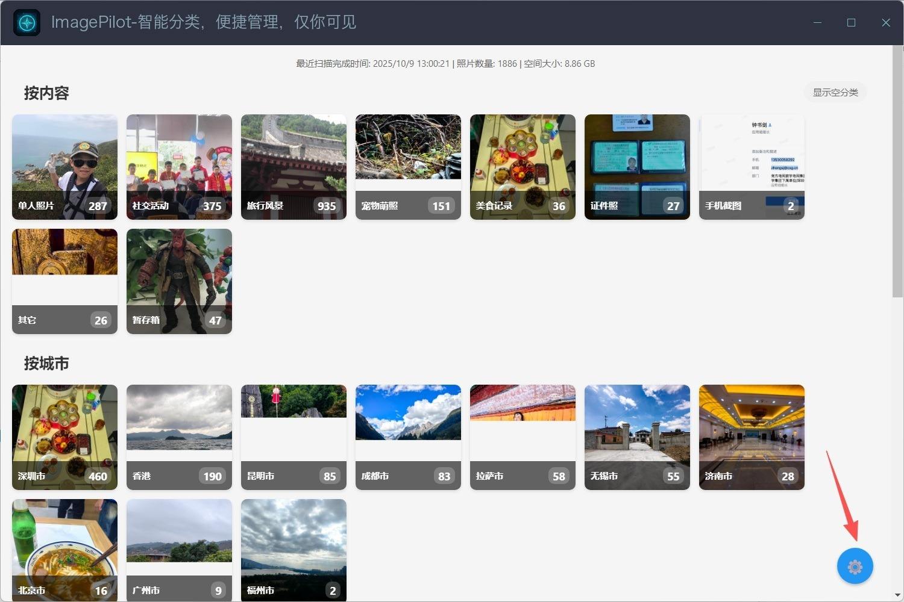
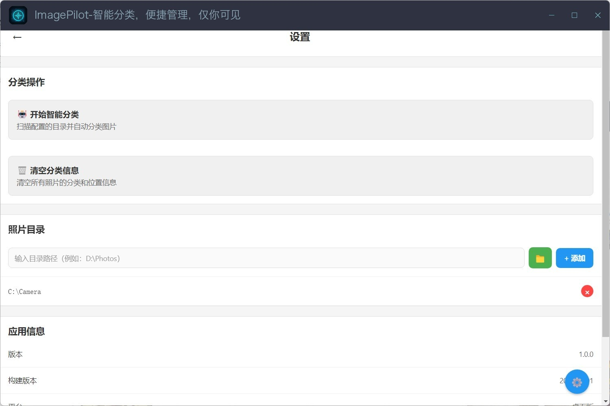
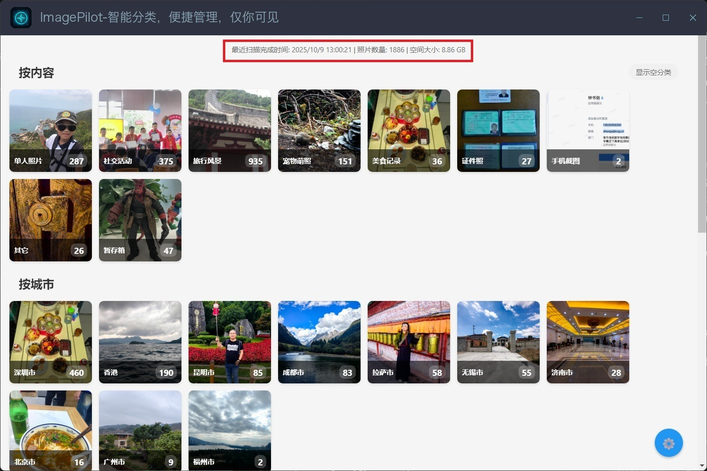
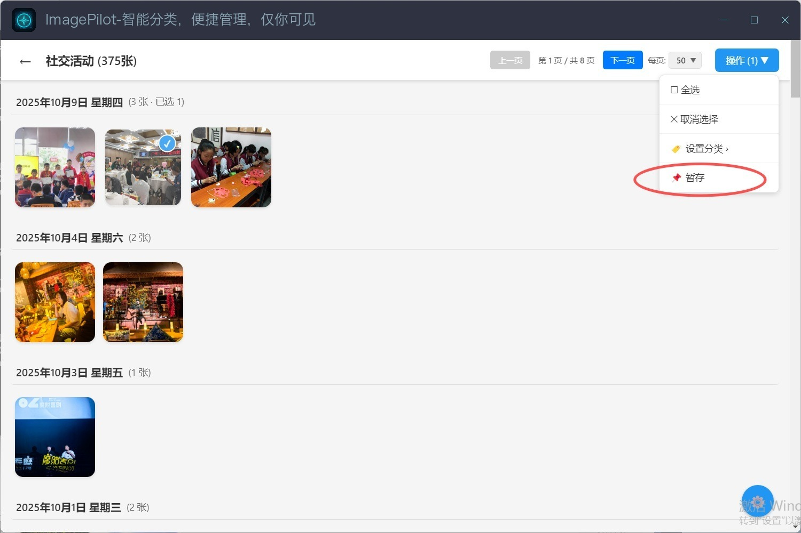
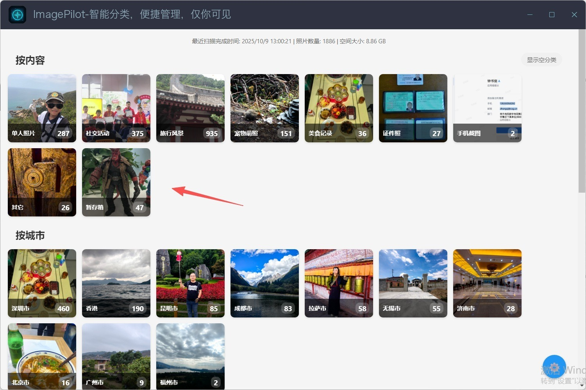
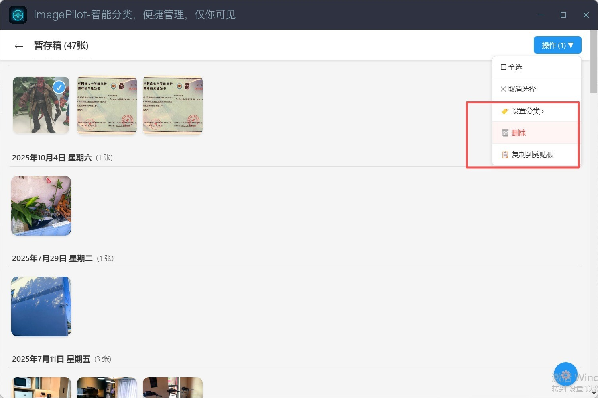

# 💭 您是否也曾经历过这样的时刻？

## 1.5.88 分类说明与描述续跑修复

- 分类前使用全部有效内置类别和用户自定义类别；排除待分类桶及用户删除的内置类别。自定义规则优先，详情仅展示得分前五项。
- 删除可绕过完整类别含义的裸名称短标签。明确单人主体、奖杯/艺术品、网络机柜/电子设备的语义；分类管理页与模型共用类别说明。
- 启用描述后，每最多 8 张新分类图片切换至 LFM 补描述；两种模型串行释放/加载，不同时驻留。已有描述保留。
- pending/failed 状态随图片持久化并保留在相册精简缓存。再次运行全量离线分类时优先补齐未完成描述，即使待分类数量为零；单独选图仍只处理所选图片。
- 进度区明确显示“正在生成图片描述”，停止和描述失败不再一概提示全部完成。不会自动调用外部 API。

这是小样本修复验证，不代表整体分类准确率；中文小模型仍可能误读图片文字。模型文件无需重下。

## 1.5.87 离线描述修复与分类改进

选中「设置 → 分类模型 → EmbeddingGemma 2」后打开“生成图片描述”，展开 LFM2.5-VL-450M（约 419 MB）的“下载并启用”入口，下载完成自动生效。描述跟随系统语言；关闭保留文件，默认关闭。已修复 Android 旧架构缺少 clearCache 原生方法导致描述为空的问题。

EmbeddingGemma 先完成分类并释放内存，LFM 再生成真实图片描述，写入图片信息并支持搜索。失败不会清空已有描述，也不会自动调用外部 API。启用后处理时间和耗电会增加；中途停止保留已完成结果，未生成的描述可通过重新执行 AI 分类补齐。已分类图片不会因打开开关自动重跑。

Android 发布 APK；iOS 1.5.87（build 13）已用开发签名安装到连接的 iPhone 13，先真机测试，不提交 App Store。两端 CPU 两线程，验证及资产信息见 [1.5.87 发布记录](../../docs/releases/v1.5.87.md)。模拟器测试不代表手机温升、耗电或整体准确率。

## 1.5.85 Android 应用内更新

下载完成后的安装错误会显示原始原因，支持复用本地 APK 重试安装，不再自动跳浏览器。安装包使用应用私有缓存，不位于公共 Download 目录。安装权限仍需在系统设置中授权。旧版安装本版时仍运行旧逻辑，必要时手动覆盖安装一次；新流程在安装本版后生效。

## EmbeddingGemma 2 图文分类测试版（2026-11-05）

> 1.5.84 修正：完整类别描述参与匹配；已有图片描述保留；新结果展示类别说明和候选相似度，不以百分比冒充置信概率。仍不生成自由图片描述，旧结果须重新分类。

Android 测试版本为 **1.5.83-beta.1**，iOS 已接入同一能力，但本次仅提供 Android APK。进入「设置 → 分类模型 → EmbeddingGemma 2 · 测试版」，下载约 **388 MB** 的 440M 图文模型后选择使用。模型不内置 APK，无需同时下载 Gemma4-E2B。

图像与类别名称/规则分别编码为向量，按语义相似度归类，支持自定义类别；不生成图片描述，也不支持文本润色。复杂规则的效果须实测。两端均用 CPU，不依赖 GPU。项目没有语音输入/语音识别，幻灯片背景音乐只是播放，因此无需 740M 音频版。

本地分类与外部 API 是用户主动选择的两种方式。该模型下载或推理失败不会自动调用外部 API。切换模型后，可在分类页选中同一批照片执行「AI 分类」重新测试；仅增量扫描不会重跑所有已分类照片。模型准确率、持续运行温升和耗电尚待真机测试，不能视为已改善。

在旅途中，我们举起镜头，想要留住山河壮阔的壮丽瞬间；在聚会时，我们按下快门，渴望定格与好友欢聚的每一张笑脸；回到家中，我们随手一拍，记录下家人的温情陪伴与宠物的暖心依赖；甚至当美食上桌，我们也习惯性地“咔嚓”一声，将色香味俱全的体验封存为永恒的记忆……

科技让拍照变得轻而易举，却也带来了“幸福的烦恼”。为了捕捉最完美的瞬间，我们常常对同一场景连拍数张；工作之中，相机也成为得力助手——会议实录、资料拍摄、事实留存、沟通截图……大量的图片无声地堆积在手机相册中，其中有珍贵的文档、美好的回忆，也有重要的凭证。

日积月累，手机存储空间频频告急，而云备份又让人担忧隐私安全。如何高效整理海量照片，在释放空间的同时，守护每一份珍贵记忆，已成为我们每个人都需要面对的日常课题。

**ImagePilot，正是为您解决这一难题而生的智能伙伴。**

我们运用最新AI技术，在您的设备本地即可对照片进行智能识别与分类。无需登录、无需网络、更无任何内嵌广告——从根源上杜绝隐私泄露风险，给您纯粹、安心的整理体验。

# 📁 核心功能：智能分类，便捷管理

· 支持按内容、城市、颜色、存储、格式、分辨率、方向、相似组共 **8 大维度**进行分类
· 内容识别覆盖 **20 个类别**：单人照、社交活动、儿童、宠物、旅行风景、夜景、建筑、植物花卉、美食、车辆、运动健身、服饰穿搭、商品、电子产品、文档票据、证件照、艺术绘画、卡通表情、手机截图、二维码
· 设备端「AI 智能识别」采用 MobileCLIP2-S2 多模态模型，本地离线、不上传；也可选配您自己的在线大模型
· 用不到的内置分类可在「自定义分类」里删除（照片回到「待分类」不丢失、可恢复），也可新增自定义分类
· 如有个别分类有误，您也可手动调整，灵活又贴心

# 📋 操作指引：四步完成相册焕新

以手机相册清理为例，轻松上手：

1. 🔗 连接与设置
       使用数据线连接手机与电脑，在设置页面选定需要整理的相册目录。

  
  

2. 🤖 一键智能分类
       点击"开始智能分类"，AI将自动扫描识别，首页清晰展示分类进度与图片统计。

  

3. ✅ 便捷拣选暂存
       分类完成后，可逐类浏览，轻松勾选需要处理的作品，一键移入暂存箱。

  

4. 🗑️ 最终清理或归档
       进入暂存箱二次确认，无误后全选删除，或复制到指定文件夹完成归档。

  
  

### 1.5.87：EmbeddingGemma 2 描述开关

选择 EmbeddingGemma 2 后，在该模型下打开“生成图片描述”，展开 LFM 下载入口。点击“下载并启用”，完成文件校验后自动用于后续分类；已有模型无需重复下载。关闭开关收起配置并保留模型文件。描述语言跟随设备系统语言：中文使用中文，其它语言使用英文，不再提供独立语言按钮；旧语言偏好不再用于描述生成。

Android 描述为空已定位为旧架构缺少 clearCache 桥接，并在 1.5.87 补齐；安装包及 iOS 签名状态见发布记录。
